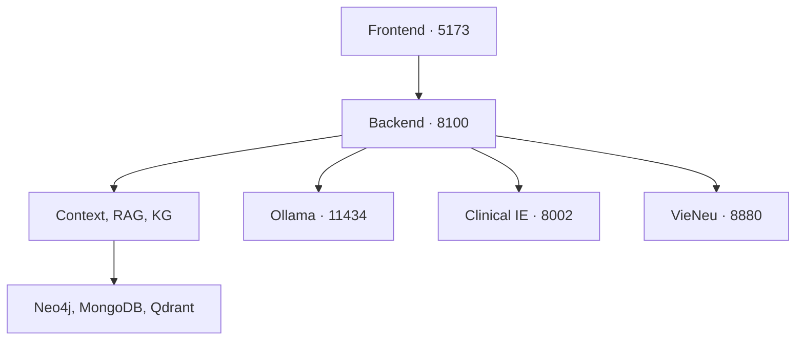

# medical-ai-integrated — Tài liệu cài đặt và sử dụng

**Tên hiển thị:** PulmoGraph AI. **Môi trường hướng dẫn:** Windows, Command Prompt (CMD). **Phạm vi:** mã nguồn tích hợp trong gói dự án đã cung cấp và các bản vá được bàn giao riêng. Phiên bản thực tế trên máy phụ thuộc vào bản vá đã áp dụng, cấu hình và dữ liệu đang được kích hoạt.

## 1. Dự án làm gì?

PulmoGraph AI là hệ thống nghiên cứu hỗ trợ hỏi đáp y khoa. Người dùng có thể hỏi từ tài liệu, tra quan hệ trong đồ thị tri thức, xác nhận dữ kiện cho một lượt đánh giá hoặc gửi đầu vào lâm sàng. Câu trả lời phụ thuộc vào dữ liệu đã nạp, mô hình đang chạy và bằng chứng truy xuất được. Kết quả của mô hình cần được người có chuyên môn kiểm tra trước khi dùng trong quyết định lâm sàng.

| Thành phần | Vai trò |
|---|---|
| Frontend React, TypeScript, Vite | Trang giới thiệu, hội thoại, nguồn, đánh giá tương tác, giọng nói và cài đặt |
| Backend FastAPI | API điều phối, lưu hội thoại và tệp, gọi mô hình, gắn các module nội bộ |
| Context | Phân giải tham chiếu, lưu History và quản lý dữ kiện Patient Graph theo phiên |
| E5 + SVM | Tạo embedding câu hỏi và chọn nhánh xử lý. Artifact SVM nằm tại `backend/models/E5_SVM_seed456.joblib` |
| RAG | Nạp tài liệu, chia đoạn, tìm đoạn/mệnh đề. Chế độ live dùng MongoDB, Qdrant và embedding E5 |
| KG | Kiểm tra dữ liệu, tra thực thể và quan hệ, tìm đường, so sánh, xem bằng chứng, duyệt và phát hành snapshot |
| Ollama | Chạy Qwen để xử lý ngôn ngữ và diễn đạt phản hồi theo ngữ cảnh/bằng chứng |
| Clinical IE | Tiến trình riêng cho văn bản, X-quang, kết hợp và yêu cầu đánh giá triệu chứng |
| Voice | STT chuyển tiếng nói thành chữ trong backend. VieNeu chạy TTS ở tiến trình riêng |



Context, RAG, KG và KG Explorer được gắn trong cùng tiến trình backend. Backend dùng SQLite để lưu hội thoại, trạng thái đánh giá và metadata xử lý tệp. Tệp gốc được lưu ở đường dẫn upload đã cấu hình.

| Đường dẫn mã nguồn | Nội dung |
|---|---|
| `backend/app/main.py`, `integrated.py` | API chính, khởi tạo và mount module |
| `backend/app/services/` | Điều phối chat, classifier, Ollama, truy xuất và bằng chứng |
| `backend/app/modules/` | Context, RAG, KG Import và KG Query |
| `backend/app/kg_global/`, `direct_import/`, `data_workspace/` | Kho KG toàn cục, công việc nạp và giao diện quản lý |
| `backend/clinical_service/` | Adapter Clinical IE và engine bàn giao |
| `backend/scripts/`, `backend/examples/` | Công cụ dòng lệnh, ontology và dữ liệu mẫu |
| `frontend/src/`, `frontend/tests/`, `backend/tests/` | Giao diện, API client và kiểm thử |
| `windows_quick/`, `medical_db_tools/` | Bộ khởi động và quản lý CSDL trên Windows |

## 2. Chuẩn bị trên Windows

1. Cài **Python 3.12** và Python Launcher `py`. Bộ chạy chính chấp nhận môi trường sẵn có Python 3.11 hoặc 3.12. Clinical IE dùng 3.12.
2. Cài **Node.js 22 trở lên**, có npm. Nếu dùng bộ CSDL đi kèm, chuẩn bị Docker Desktop chạy Linux containers.
3. Chuẩn bị Ollama Windows và model được cấu hình. Chuẩn bị đủ chỗ cho cache, checkpoint, dữ liệu và snapshot. Lần tải model hoặc image đầu cần mạng phù hợp.
4. Giải nén dự án sao cho thư mục gốc chứa trực tiếp `backend`, `frontend`, `windows_quick` và các BAT. Các lệnh dưới dùng đường dẫn dự án của bạn.

```bat
cd /d D:\medical_wed\banmoi\medical-ai-integrated
py -3.12 --version
node --version
npm --version
ollama list
```

Giữ lại môi trường và dữ liệu cũ nếu đang nâng cấp. Khi chuyển dự án sang đường dẫn mới, tạo lại venv ở vị trí mới và kiểm tra đường dẫn tuyệt đối của model, SQLite và tệp upload cũ.

### 2.1. Chọn CSDL

| Tình huống | Thao tác |
|---|---|
| Đã có Neo4j, MongoDB, Qdrant chứa dữ liệu cần dùng | Giữ các dịch vụ đó và trỏ cấu hình vào đúng URI, database và collection hiện có |
| Cài bộ CSDL mới | Chạy `SETUP_DATABASES.bat`. Bộ cài tạo bộ CSDL riêng, kiểm tra kết nối và cập nhật các dòng kết nối trong `backend/.env` sau khi thành công. CSDL mới cần nạp hoặc phục hồi dữ liệu |
| Khởi động bộ đã tạo | Chạy `START_DATABASES.bat`. Xem cổng trong `medical_db_tools/CONNECTIONS.txt` |
| Cài dở hoặc lỗi Docker | Giữ `medical_db_tools/state.json`, xem `logs/databases-setup-*.log` rồi chạy lại SETUP sau khi xử lý lỗi |

Bộ CSDL quản lý Neo4j, MongoDB và Qdrant. Mở Ollama Windows riêng. Với bộ tự cài, cổng có thể được chọn theo cổng trống và chỉ bind vào loopback. Giữ bản sao `.env` trước khi đổi kết nối. Nếu đích mới trống, các tài liệu của bộ cũ chỉ xuất hiện sau khi bạn nạp, phục hồi hoặc trỏ lại đúng bộ cũ.

### 2.2. Cấu hình backend

Nếu chưa có cấu hình, sao chép mẫu ở **thư mục gốc**. Nếu đã có `backend/.env`, mở để đối chiếu từng nhóm biến.

```bat
if not exist backend\.env copy env.example backend\.env
notepad backend\.env
```

| Nhóm | Biến quan trọng và cách chọn |
|---|---|
| Ollama | `OLLAMA_BASE_URL=http://127.0.0.1:11434`, `OLLAMA_MODEL=qwen2.5:7b` nếu đó là máy chủ và tag đã kiểm tra. Context có cấu hình riêng `CONTEXT_OLLAMA_BASE_URL`, `CONTEXT_OLLAMA_MODEL` |
| Context | `CONTEXT_GRAPH_BACKEND`, `CONTEXT_NEO4J_URI`, `CONTEXT_NEO4J_USER`, `CONTEXT_NEO4J_PASSWORD`, `CONTEXT_NEO4J_DATABASE`, `CONTEXT_NLP_BACKEND`, `CONTEXT_EMBEDDING_BACKEND` |
| RAG | `RAG_MODE=live`, `RAG_MONGO_URI`, `RAG_MONGO_DB`, `RAG_QDRANT_URL`, `RAG_QDRANT_API_KEY`. Chế độ `demo` dùng SQLite lexical `RAG_DEMO_DB`, phù hợp kiểm tra đơn giản |
| KG | `KG_NEO4J_URI`, `KG_NEO4J_USERNAME`, `KG_NEO4J_PASSWORD`, `KG_NEO4J_DATABASE`, `KG_MONGODB_URI`, `KG_MONGODB_DATABASE`, `KG_ONTOLOGY_PATH`, `KG_QDRANT_URL`. Trỏ ontology tới file phù hợp với dữ liệu nhập |
| Classifier/E5 | `CLASSIFIER_PATH`, `CLASSIFIER_EMBEDDING_MODEL`, `CLASSIFIER_EMBEDDING_REVISION`, `CLASSIFIER_DEVICE`, `RAG_EMBEDDING_DEVICE`. Đối chiếu revision và thiết bị giữa các module. Dùng `auto` hoặc `cpu` khi chưa xác nhận CUDA |
| Embedding KG | `KG_ENTITY_EMBEDDING_ENABLED`, `KG_ENTITY_MODEL`, `KG_ENTITY_MODEL_REVISION`, `KG_ENTITY_DEVICE`, `KG_ENTITY_COLLECTION`, `KG_ENTITY_CACHE_DIR`. Mẫu cấu hình dùng `Dqdung205/medical_vietnamese_embedding` và tắt embedding KG ban đầu |
| Clinical/voice | `CLINICAL_IE_BASE_URL`, `CLINICAL_IE_TIMEOUT_SECONDS`, `CLINICAL_DEVICE`; `VOICE_STT_*`, `VOICE_TTS_*` |
| Lưu trữ và trình duyệt | `DATABASE_PATH` (mẫu `data/assistant.sqlite3`), `UPLOAD_DIR` (mẫu `data/uploads`), `MAX_UPLOAD_MB` (mặc định 20), `CORS_ORIGINS` |

Dùng giá trị thật thay cho `YOUR_*` và đường dẫn mẫu. Sau khi đổi `.env`, khởi động lại dịch vụ tương ứng. Khi đổi model embedding, kiểm tra kích thước vector và tạo lại index cần thiết theo module. Các vector cũ chỉ tương thích khi dùng cùng quy trình embedding. Nếu bật `KG_ENTITY_TRUST_REMOTE_CODE`, kiểm tra mã model và dùng revision đã duyệt trước khi chạy.

### 2.3. Cấu hình frontend

Tạo hoặc sửa `frontend/.env`:

```dotenv
VITE_USE_MOCK_API=false
VITE_API_BASE_URL=http://127.0.0.1:8100
VITE_CHAT_TIMEOUT_MS=600000
VITE_FILE_PROCESSING_TIMEOUT_MS=600000
```

`VITE_USE_MOCK_API=true` dùng dữ liệu mô phỏng cho giao diện. Sau khi đổi biến Vite, khởi động lại dev server hoặc build lại. Giữ origin thực tế của frontend trong `CORS_ORIGINS` nếu gọi backend khác origin.

## 3. Cài và khởi động

### 3.1. Cách dùng BAT

1. Mở CSDL và Ollama. Dùng `ollama list` để kiểm tra tag đang cấu hình. Nếu cần tải model, chạy `ollama pull qwen2.5:7b`.
2. Sau khi tạo `backend/.env`, chạy `INSTALL.bat` lần đầu. Nhật ký cài ở `logs/install-backend.log` và `logs/install-frontend.log`.
3. Chạy `RUN.bat`. Bộ chạy có thể tự gọi bước cài khi thiếu môi trường hoặc dependency frontend. `START_BACKEND.bat` và `START_FRONTEND.bat` dùng để mở riêng. `START_ALL.bat` mở bộ ứng dụng và các dịch vụ tùy chọn nếu môi trường tương ứng đã có. CSDL và Ollama cần được mở riêng.
4. Mở `http://127.0.0.1:5173`. Đóng tiến trình bằng **Ctrl+C** trong cửa sổ tương ứng trước khi chạy lại.

### 3.2. Cách chạy thủ công

CMD thứ nhất, tại thư mục gốc:

```bat
cd backend
py -3.12 -m venv .venv
.venv\Scripts\python.exe -m pip install -r requirements.txt
.venv\Scripts\python.exe -m pip check
.venv\Scripts\python.exe -m uvicorn app.main:app --host 127.0.0.1 --port 8100 --workers 1
```

Chỉ tạo/cài venv lần đầu hoặc khi cần sửa dependency. Nếu dự án dùng `venv` thì thay đường dẫn tương ứng. Dùng một worker vì model và hàng đợi/khóa module có phạm vi tiến trình.

CMD thứ hai, tại thư mục gốc:

```bat
cd frontend
npm ci
npm run dev -- --host 127.0.0.1 --port 5173 --strictPort
```

Khi cần gói tĩnh, chạy `npm run build` trong frontend và phục vụ `frontend/dist`. Nếu dùng máy chủ tĩnh, cấu hình SPA fallback cho `/chat/*` và `/settings`. Cấu hình API/CORS theo origin thực tế. Giữ dịch vụ ở loopback cho môi trường nghiên cứu cục bộ. Khi triển khai nhiều người dùng, cần thiết kế xác thực, phân quyền và cô lập dữ liệu riêng.

### 3.3. Kiểm tra lần chạy đầu

| Địa chỉ | Kiểm tra |
|---|---|
| `http://127.0.0.1:5173/` | Website, vào chat từ trang giới thiệu |
| `http://127.0.0.1:8100/health/live` | Tiến trình backend phản hồi |
| `http://127.0.0.1:8100/api/v1/status` | Trạng thái các dependency và chế độ |
| `http://127.0.0.1:8100/docs` | OpenAPI backend chính |
| `http://127.0.0.1:8100/data` | Quản lý dữ liệu |
| `http://127.0.0.1:8002/health` | Kiểm tra dịch vụ Clinical IE nếu đã mở. Cần gọi thử phân tích để xác nhận runtime/model |
| `http://127.0.0.1:11434/api/tags` | Ollama phản hồi và liệt kê model |

```bat
curl.exe -i http://127.0.0.1:8100/api/v1/status
curl.exe -i http://127.0.0.1:11434/api/chat -H "Content-Type: application/json" -d "{\"model\":\"qwen2.5:7b\",\"stream\":false,\"messages\":[{\"role\":\"user\",\"content\":\"Xin chao\"}]}"
```

Dòng `Application startup complete` xác nhận tiến trình đã lên. Tìm thêm `module.started` hoặc `module.startup_failed` cho từng module. Module lỗi khởi tạo có thể trả 503 trong khi module khác vẫn chạy.

## 4. Sử dụng hội thoại và đọc nguồn

1. Vào **Trò chuyện mới**, nhập một câu hỏi rõ chủ đề. Dùng tên chuẩn, đặc biệt khi tên bệnh có nhiều viết tắt.
2. Xem kết quả và mở nguồn đánh số nếu có. Kiểm tra tài liệu, đoạn trích, hướng quan hệ, điều kiện và phủ định.
3. Khi hỏi tiếp bằng “bệnh đó” hoặc “thuốc này”, giữ cùng cuộc trò chuyện. Khi đổi bệnh nhân hoặc muốn kiểm tra độc lập, mở cuộc trò chuyện mới. Backend dùng ID hội thoại làm Patient ID và Session ID trong luồng tích hợp.
4. Nếu gặp yêu cầu làm rõ, chọn đúng thực thể nếu có lựa chọn, hoặc sửa câu hỏi bằng tên đầy đủ. Gói **top 5 + tự nhập** hiển thị tối đa năm gợi ý cho thực thể chưa rõ và thêm mục tự nhập sau các gợi ý. Khi đủ năm ứng viên, đây là lựa chọn thứ sáu. Gõ tên thay thế và xác nhận các đầu mút để tra lại. Mục tự nhập xuất hiện khi hệ thống xác định được vị trí tên trong câu gốc. Gói này nối tiếp bản top 3 và cần được áp dụng riêng.

| Câu hỏi mẫu | Nhánh cần quan sát |
|---|---|
| “Lao phổi là gì?” | Hỏi tổng quát, cần tài liệu liên quan trong RAG |
| “Lao phổi có những triệu chứng nào theo dữ liệu?” | Truy vấn quan hệ trực tiếp, cần thực thể và cạnh trong KG |
| “Mối liên hệ giữa lao phổi và COPD là gì?” | Tra hai đầu thực thể và đường liên kết. Nếu tên mơ hồ, xác nhận tên trước |
| “So sánh biểu hiện của lao phổi và COPD theo tài liệu” | So sánh hai thực thể theo tiêu chí, kiểm tra nguồn từng bên |
| “Tôi có triệu chứng A và B, muốn được hỗ trợ đánh giá” | Luồng đánh giá nếu classifier chọn đúng nhánh. Dùng dữ liệu hư cấu khi thử |
| Câu hỏi ngoài chủ đề y khoa | Kiểm tra phản hồi ngoài phạm vi |

Các ví dụ minh họa hành vi mong đợi. Nhãn thật phụ thuộc classifier và ngữ cảnh. Nếu không có nguồn phù hợp, hệ thống có thể báo chưa đủ bằng chứng dù dịch vụ vẫn hoạt động.

| Nhãn classifier | Luồng chính |
|---|---|
| `GENERAL_MEDICAL_QUERY` | RAG |
| `RELATIONAL_QUERY` | KG |
| `CLINICAL_EXPLANATION_MANAGEMENT` | RAG và KG |
| `DIAGNOSTIC_ASSESSMENT` | Phiên đánh giá có xác nhận, Clinical IE và trình bày kết quả |
| `OUT_OF_SCOPE` | Phản hồi ngoài phạm vi |

KG hỗ trợ truy vấn tự chọn, 1-hop, nhiều hop, đường đi, so sánh, điểm chung, khác biệt và suy luận giới hạn theo luật được công bố. Tra catalogue và schema ở API/module của phiên bản đang chạy. Embedding giúp tìm ứng viên khi tên/bí danh không khớp chắc chắn. Ứng viên tương tự vẫn cần xác nhận danh tính, còn quan hệ phải đến từ đồ thị và bằng chứng.

### 4.1. Đánh giá tương tác

- Đọc dữ kiện hệ thống tách từ câu vừa nhập. Sửa hoặc thêm dữ kiện, xác định có/không/không biết, hiện tại/tiền sử và đối tượng được mô tả.
- Duyệt dữ kiện cũ từ Patient Graph nếu giao diện đưa ra, chỉ chọn dữ kiện thuộc đúng bệnh nhân và còn phù hợp.
- Trả lời hoặc bỏ qua từng câu hỏi bổ sung từ KG. **Không biết** và **Bỏ qua** là hai thao tác khác nhau.
- Kiểm tra toàn bộ dữ kiện rồi nhấn **Gửi đánh giá**. Backend lưu snapshot đã xác nhận, đồng bộ dữ kiện và gọi Clinical IE. Dùng nút thử lại của lượt đánh giá khi có lỗi. Nếu chỉ lỗi Patient Graph, dùng thử đồng bộ riêng khi giao diện cung cấp.
- Đọc kết quả cùng dữ kiện đã xác nhận và nguồn. Lượt mới có thể dùng lại lịch sử của đúng hội thoại, nên chọn **Trò chuyện mới** khi đổi người.

### 4.2. Phân tích TXT và X-quang

1. Chạy `INSTALL_CLINICAL.bat` ở gốc hoặc `backend/install_clinical_windows.bat`. Môi trường riêng là `backend/.venv-clinical`.
2. Kiểm tra bundle bằng lệnh dưới. Tài liệu bàn giao ghi hai trọng số NLP có thể thiếu tại `joint/final_model/model.safetensors` và `simplifier/final_model/model.safetensors` trong bundle Clinical IE. Dùng kết quả kiểm tra trên máy để xác định chính xác. Đường dẫn tùy chỉnh dùng `CLINICAL_IE_BUNDLE`, `CLINICAL_FUSION_BUNDLE`, `CLINICAL_REFERENCE_BUNDLE` khi cần.
3. Mở `START_CLINICAL.bat` và kiểm tra cổng 8002. Trong chat, chọn loại đầu vào, đính kèm TXT, ảnh X-quang PNG/JPEG hoặc kết hợp nếu giao diện hỗ trợ. Kiểm tra tệp và nhấn **Gửi**. Xem tiến độ và kết quả phân tích trong hội thoại.
4. Thử riêng từng loại đầu vào để phân biệt lỗi model NLP, model ảnh và kết hợp. Luồng phân tích này đi trực tiếp tới Clinical IE, khác với phiên hỏi đáp triệu chứng có xác nhận.

```bat
cd backend
.venv-clinical\Scripts\python.exe -m scripts.check_clinical_assets
.venv-clinical\Scripts\python.exe -m pip check
```

### 4.3. Giọng nói

- Chạy `INSTALL_VOICE.bat` để cài STT và môi trường VieNeu riêng. Cấu hình `VOICE_STT_MODEL` theo model thực có trên máy (mẫu dùng PhoWhisper dạng CTranslate2), cùng thiết bị và kiểu tính toán phù hợp.
- Cấu hình `VOICE_TTS_PROVIDER=vieneu`, `VOICE_TTS_BASE_URL=http://127.0.0.1:8880/v1`, tên model/giọng theo dịch vụ, rồi chạy `START_VOICE.bat`. Các launcher GPU nằm trong `backend/`; kiểm tra riêng driver và runtime trước khi chọn GPU.
- Trong chat, cấp quyền micro, thu âm, kiểm tra nội dung nhận dạng và phát lại phản hồi. Khi cần phát theo câu hoàn chỉnh, đặt `VITE_VOICE_PLAYBACK_MODE=smooth` trong `frontend/.env` rồi khởi động lại frontend.

## 5. Quản lý và nạp dữ liệu

Mở **Quản lý dữ liệu** ở thanh bên hoặc vào `http://127.0.0.1:8100/data`. Bắt đầu với một mẫu nhỏ và kiểm tra đúng bộ CSDL, nguồn dữ liệu, kết quả job trước khi nhập lô lớn. Các mục khả dụng phụ thuộc module đã khởi tạo.

### 5.1. RAG — Tài liệu và mệnh đề

1. Vào mục **RAG**, chọn tải một hoặc nhiều JSON, hoặc chạy nạp thư mục nguồn mà giao diện hiển thị. Xem mẫu trong `backend/examples/rag` và `RAG_BATCH_IMPORT_VI.md`.
2. Kiểm tra schema và chạy validate/dry run trước khi ghi. Nạp tài liệu và xem báo cáo từng file. Sửa file lỗi rồi nạp lại file đó. Tài liệu không đổi có thể được bỏ qua.
3. Kiểm tra danh sách tài liệu, đoạn chia, mệnh đề và kết quả tìm kiếm. Khi thử chat, dùng câu hỏi có thể đối chiếu với một tài liệu đã nạp. Backend khởi động không tự nạp tài liệu.
4. Với `RAG_CHUNK_METHOD=semantic`, việc chia đoạn dựa trên section và ranh giới ngữ nghĩa. Khi đổi cấu hình chia hoặc embedding, lập kế hoạch reindex và kiểm tra nguồn sau khi nhập lại.

CLI gọi backend đang chạy, thực hiện từ `backend`:

```bat
.venv\Scripts\python.exe -m scripts.rag.import_folder --mode validate
.venv\Scripts\python.exe -m scripts.rag.import_folder --mode dry_run
.venv\Scripts\python.exe -m scripts.rag.import_folder --file DOC_000005.json
```

Thay tên mẫu bằng file thật trong thư mục nguồn cấu hình. Có thể dùng `--base-url` khi backend chạy cổng khác và `--reports-dir` để tải báo cáo.

### 5.2. KG — Import, định danh và phiên bản đang phục vụ

KG nguồn cần tài liệu, thực thể, quan hệ và bằng chứng theo schema của bộ nhập. Kiểm tra ontology cho **loại đầu nguồn, loại đầu đích, tên và hướng quan hệ**. Với `kg_merged (5).json` hoặc file xuất từ pipeline khác, kiểm tra schema trong bước xem trước trước khi chọn luồng nạp. JSON nguồn và JSON snapshot phục hồi có mục đích khác nhau.

**Luồng đang dùng trong mã đã rà soát**

1. Mở **Quản lý dữ liệu → Knowledge Graph → Nhập KG** hoặc `http://127.0.0.1:8100/direct-import`. `/kg-global` mở cùng giao diện. Các API ghi import/review cũ có thể trả 410 theo `LegacyImportGuard`. Quy trình chốt, đồng bộ và kích hoạt bằng ba nút riêng trong tài liệu cũ chỉ áp dụng cho phiên bản trước.
2. Chọn đích **KG**, **RAG** hoặc **Cả KG và RAG**. Chọn JSON hoặc ZIP theo hợp đồng của dự án, giới hạn trên giao diện là 20 MiB cho JSON và 64 MiB cho ZIP. Với ZIP, chọn đúng bản dữ liệu trong gói và giữ sidecar ánh xạ nguồn nếu cần truy vết tài liệu thành phần. Nếu ZIP kèm ontology, ontology phải khớp cấu hình. Một JSON hợp nhất đơn lẻ chỉ truy vết được các nguồn mà JSON đó thực sự chứa.
3. Nhấn **Kiểm tra và nhập**. Thao tác này ghi dữ liệu. Hệ thống kiểm tra schema, cập nhật định danh, tạo snapshot, đồng bộ và **tự kích hoạt KG sau khi đồng bộ thành công**. Thử trên CSDL riêng trước nếu cần xem kết quả mà chưa đổi snapshot phục vụ. Luồng nhập trực tiếp tắt bước lập chỉ mục embedding KG trong lần publish. Với đích **Cả KG và RAG**, nếu KG thành công nhưng RAG lỗi, job có thể ở trạng thái `partial`; kiểm tra lỗi rồi thử lại riêng RAG.
4. Xem lịch sử job, snapshot ID, số thực thể/cạnh và cảnh báo. Mở KG Explorer để kiểm tra một tên chuẩn, một alias, một cạnh và nguồn đã biết. Truy vấn chat dùng snapshot active.
5. Trong khu vực định danh, chọn **Đọc danh sách** để duyệt tên/alias mơ hồ. Có thể xác nhận giữ riêng, hợp nhất có chủ đích hoặc duyệt/từ chối bí danh. Với thực thể khác loại, kiểm tra đồng nhất khái niệm, thuộc tính và tất cả ràng buộc domain/range, hướng cạnh và self-loop. Sau khi lưu quyết định, **nhập lại file** để đưa thay đổi bản nháp vào snapshot phục vụ. Duyệt alias tự nó chỉ sửa bản nháp.

Với bản vá import/alias đã rà soát, tên và alias trùng tạo danh sách ứng viên. Graph mới dùng tên/alias thuộc tính trên entity và chỉ chiếu thực thể là đầu mút bộ ba; thực thể cô lập vẫn có thể xem trong dữ liệu nguồn/snapshot. Quan hệ giữ các phát biểu nguồn và bằng chứng. Bước xác minh projection kiểm tra dữ liệu graph trước khi cho snapshot mới hoạt động. Nếu job báo lỗi ghi, xem log, xác nhận snapshot active và thử lại sau khi xử lý dịch vụ.

**Kiểm tra JSON và graph từ thư mục backend**

```bat
.venv\Scripts\python.exe scripts/kg/audit_kg_source.py "D:\du_lieu\kg_merged (5).json"
.venv\Scripts\python.exe scripts/kg/verify_kg_fixture.py "D:\du_lieu\kg_merged (5).json"
```

Đổi sang đường dẫn file thực tế. Hai lệnh trên lần lượt kiểm toán nguồn và kiểm thử snapshot/projection offline. Đối chiếu Neo4j đang chạy bằng `scripts/kg/audit_neo4j_graph.py` với cấu hình CSDL đúng. Nếu dữ liệu cũ từng tự gộp alias, cài patch không tự tách các định danh đã gộp. Xem quy trình dựng registry riêng trong `docs/kg/KG_IMPORT_ALIAS_FIX_VI.md` trước khi di trú.

### 5.3. Context và Patient

- Mở **Context & Patient** trong Quản lý dữ liệu hoặc `/modules/context/ui` để kiểm tra Session, History, phân giải tham chiếu và dữ kiện Patient Graph.
- Nếu nhập dữ liệu Context theo lô, chọn đúng loại JSON, kiểm tra Patient/Session ID, xem trước rồi xác nhận. Đối chiếu báo cáo job và JSON nguồn. Xem `BATCH_IMPORT_KG_CONTEXT_VI.md` để biết mẫu cho từng loại.
- History lưu diễn tiến hội thoại và các thực thể được nhắc đến. Patient Graph lưu dữ kiện gắn bệnh nhân theo điều kiện của luồng ghi. Hai phần này có vòng đời riêng với lịch sử chat trong SQLite. Khi kiểm tra hoặc phục hồi, xác định rõ kho nào cần thao tác.

## 6. API và điểm vào kỹ thuật

Dùng OpenAPI của tiến trình đang chạy để lấy schema request/response chính xác. Các ví dụ dưới là điểm vào, không cần thêm một máy chủ riêng cho từng module tích hợp.

| API/trang | Công dụng |
|---|---|
| `POST /api/v1/chat/message` | Gửi chat và nhận phản hồi hoặc phiên đánh giá |
| `GET /api/v1/conversations`, `GET /api/v1/conversations/{id}` | Danh sách và chi tiết hội thoại |
| `GET /api/v1/assessments/{id}`, `POST /api/v1/assessments/{id}/actions` | Theo dõi và thực hiện từng bước đánh giá |
| `POST /api/v1/clinical/analyze`, `GET /api/v1/clinical/jobs/{job_id}` | Gửi phân tích đa phương thức và theo dõi job |
| `POST /api/v1/direct-import`, `GET /api/v1/direct-import/jobs`, `GET/POST /api/v1/direct-import/identity` | Nạp trực tiếp, theo dõi và duyệt định danh |
| `POST /api/v1/files/medical-record`, `POST /api/v1/files/xray`, `GET /api/v1/files/{id}` | Điểm vào tệp và trạng thái xử lý. Kiểm tra schema đang chạy cho chế độ kết hợp |
| `/api/v1/voice/config`, `/api/v1/voice/transcribe`, `/api/v1/voice/speech` | Cấu hình giọng nói, chuyển âm thanh thành chữ, tổng hợp giọng nói |
| `/modules/context/docs`, `/modules/context/v1/context/resolve` | API Context |
| `/modules/rag/`, `/modules/rag/docs` | Giao diện và API RAG |
| `/modules/kg/docs`, `POST /modules/kg/api/v1/kg/query` | KG Retrieval, Import và Validate |
| `/modules/kg-explorer/` | Duyệt và kiểm tra KG trực tiếp |
| `/api/v1/data/config`, `/api/v1/data/overview`, `/api/v1/data/jobs` | Tổng hợp cấu hình, dữ liệu và job của trang Quản lý dữ liệu |

## 7. Kiểm thử và xử lý lỗi

### 7.1. Kiểm thử mã và môi trường thật

Chạy từ hai thư mục tương ứng. Dùng môi trường kiểm thử riêng hoặc kiểm tra cấu hình fixture trước khi chạy các bài kiểm thử có đụng dịch vụ ngoài.

```bat
cd backend
.venv\Scripts\python.exe -m pip install -r requirements-dev.txt
.venv\Scripts\python.exe -m pytest -q
```

```bat
cd frontend
npm test
npm run build
```

Để kiểm tra trên Windows với dữ liệu thật, dùng **gói kiểm tra truy vấn UTF-8** đã bàn giao. Giải nén vào `kiem_tra_truy_van` bên trong thư mục gốc, cùng cấp với `backend`. Dừng backend chính, giữ CSDL và Ollama, chạy `TEST_TAT_CA_TRUY_VAN.bat`. Bộ test mở backend chẩn đoán cổng **8111** và ghi ZIP dưới `kiem_tra_truy_van/query_test_logs/`. Tìm dòng **SEND THIS ZIP**. Có thể dùng `TEST_NHANH.bat`, `TEST_CLASSIFIER_CPU.bat` hoặc `TEST_BACKEND_DANG_CHAY.bat` tùy mục tiêu. Chế độ backend đang chạy chỉ lấy kết quả HTTP và có thể tạo hội thoại mẫu. Các phiên chẩn đoán cũng có thể tạo dữ liệu History mẫu trong dịch vụ ngoài.

Đọc `summary.json`, `backend.log`, `classifier-probe.log` và `requests.jsonl`. HTTP 200 chỉ xác nhận API phản hồi. Kiểm tra thêm route, thực thể đã chọn, dữ kiện, nguồn và câu trả lời. Mã thoát 2 của bộ test báo có lỗi hoặc lượt chạy gián đoạn. Gói test tập trung vào truy vấn, cần thử upload, Clinical IE, giọng nói và thao tác duyệt riêng.

### 7.2. Bảng xử lý các lỗi đã gặp

| Triệu chứng | Cách kiểm tra và xử lý |
|---|---|
| BAT báo thiếu `update_code.py` | Giải nén đầy đủ gói. Giữ BAT, `update_code.py`, `manifest.json` và `payload` trong cùng thư mục gói. Chạy BAT từ bản đã giải nén |
| Báo file đích khác bản gốc | Bộ cập nhật từ chối ghi đè để giữ sửa đổi hiện có. So sánh file đích với bản mà manifest hỗ trợ. Nếu có sửa cục bộ, hợp nhất trên file hiện tại trước khi áp dụng |
| `WinError 10048` tại 8002/8100 | Cổng đã được tiến trình khác dùng. Dùng `netstat -ano \| findstr :8002` rồi `tasklist /FI "PID eq 42396"` với PID thực tế. Nếu đúng là dịch vụ đang cần, kiểm tra health và dùng tiến trình đó. Nếu là bản cũ, dừng từ cửa sổ tương ứng rồi chạy lại |
| `OSError 1455` khi tải E5 | Windows báo giới hạn bộ nhớ cam kết/paging file. Dừng tiến trình model chạy trùng, kiểm tra RAM, dung lượng ổ và cấu hình bộ nhớ ảo của Windows. Khởi động lại backend, kiểm tra riêng `module.started name=rag` |
| `ModuleNotFoundError: portalocker` ở Clinical IE | Kiểm tra đúng Python `.venv-clinical`. Chạy lại installer hoặc bổ sung dependency vào môi trường này bằng `.venv-clinical\Scripts\python.exe -m pip install portalocker` từ backend, chạy `pip check`, rồi khởi động và gọi thử phân tích |
| HTTP 502, `AssertionError` | Lấy traceback bằng bộ test và đọc `classifier-probe.log`. Nếu lỗi ở CUDA, kiểm tra Torch trong venv backend và chạy probe CPU để so sánh. Xem vị trí lỗi trước khi đổi thiết bị |
| HTTP 502, `HTTPStatusError` | Đọc URL, mã và body upstream từ log chẩn đoán. Kiểm tra đúng base URL/model của cả backend và Context. Lệnh Ollama đơn giản thành công chỉ xác nhận chính endpoint, model và payload đó |
| Neo4j cảnh báo thiếu `HAS_STATEMENT` hoặc `recorded_at` | Kiểm tra database Context đang trỏ đến và dữ liệu Patient Graph. Kho mới có thể chưa có quan hệ/thuộc tính. Đối chiếu với lỗi cuối và request ID trước khi quy cảnh báo thành nguyên nhân HTTP 502 |
| KG trả facts nhưng chat báo thiếu bằng chứng | Kiểm tra tiếp kết quả đóng gói/bộ lọc bằng chứng, nguồn của cạnh và lỗi Ollama. Số fact KG và số nguồn đưa vào câu trả lời là hai chỉ số riêng |
| Hỏi “lao và COPD” mà yêu cầu nêu hai thực thể | Thử tên chuẩn “lao phổi” và “COPD”, đối chiếu alias trong snapshot active. Xem trạng thái nhận diện thực thể, gói top 5/tự nhập và index vector nếu bật |
| Khung KG trống hoặc còn thẻ trạng thái đã gỡ | Kiểm tra gói frontend tương ứng, build đang được phục vụ và cache trang. Gỡ thẻ trạng thái chỉ thay đổi giao diện thanh bên |
| Bộ test báo `charmap` | Cập nhật gói chẩn đoán UTF-8 trong thư mục test, giữ thư mục log. Xem lỗi classifier riêng nếu probe vẫn thất bại |

Theo dõi `chat.stage`, `context.resolve`, `kg.query`, `retrieval.result`, `chat.failed` và request ID. Chỉ bật `TRACE_PIPELINE=true` khi cần chẩn đoán có kiểm soát vì log có thể chứa câu hỏi. Kiểm tra và loại dữ liệu bệnh nhân, bí mật kết nối hoặc nội dung nhạy cảm trước khi chia sẻ log.

## 8. Cập nhật, hoàn tác và sao lưu

### 8.1. Áp dụng bản vá rời

1. Đọc `HUONG_DAN.md` của đúng gói và kiểm tra bản nền. Bản vá truy vấn, top 5, khung KG và thẻ trạng thái có phạm vi riêng. Chỉ áp dụng gói đã duyệt, đúng thứ tự phụ thuộc ghi trong gói.
2. Dừng dịch vụ mà bản vá thay đổi. Giải nén toàn bộ gói vào một thư mục riêng bên trong `medical-ai-integrated`, **cùng cấp với `backend` và `frontend`** nếu gói hỗ trợ bố trí này.
3. Chạy BAT đi kèm, chẳng hạn `CAP_NHAT_TRUY_VAN.bat` hoặc `CAP_NHAT_FRONTEND.bat`. Đọc kết quả và lưu đường dẫn backup. Nếu BAT dừng do checksum khác, giữ nguyên file và xác định bản nền trước khi tiếp tục.
4. Khởi động lại dịch vụ đã sửa. Nếu frontend chạy từ `dist`, build lại. Kiểm tra cả chức năng vừa sửa và một luồng chat thường.
5. Khi cần quay lui, dùng BAT hoàn tác của đúng gói. Hoàn tác mã, kích hoạt lại snapshot KG và phục hồi CSDL là ba thao tác riêng.

### 8.2. Sao lưu theo lớp

| Lớp | Cần giữ |
|---|---|
| Mã nguồn | Commit/phiên bản Git, danh sách patch đã áp dụng và bản sao trước thay đổi |
| Cấu hình | `backend/.env`, `frontend/.env`, cấu hình CSDL và đường dẫn cache/model. Lưu riêng an toàn vì có thể có bí mật |
| Dữ liệu cục bộ | Dừng backend và chép cả thư mục dữ liệu đang dùng, SQLite, uploads và dữ liệu nguồn nhập. Kiểm tra đường dẫn trong cấu hình và metadata tệp |
| KG global | Sao lưu cả thư mục `kg_global` trong data root khi backend đã dừng và xuất JSON snapshot đã chốt. Phục hồi JSON vào kho global trống theo hướng dẫn rồi duyệt/chốt, đồng bộ, kích hoạt theo trạng thái cần phục hồi |
| Dịch vụ ngoài | Tạo backup nhất quán riêng cho Neo4j, MongoDB và Qdrant. Ghi lại phiên bản, database/collection và thông tin snapshot |
| Models | Artifact classifier, embedding và cache cần thiết, bundle Clinical IE, model STT/TTS. Ghi nguồn, revision và đường dẫn |

Có thể chạy `run_backup_models_and_data.bat` hoặc xem trước phạm vi bằng `py -3.12 backup_models_and_data.py --dry-run` tại gốc. Công cụ gom tệp của dự án. Backup dịch vụ ngoài cần thực hiện ở lớp CSDL. Khi dùng Git, kiểm tra `git status` và `git diff --cached` trước commit. Đưa vào Git mã, cấu hình mẫu và tài liệu đã duyệt. Giữ dữ liệu bệnh nhân, log, `.env`, khóa, model lớn, venv và Docker volume ngoài commit.

## 9. Tài liệu nguồn trong dự án

| Tệp | Nội dung để đối chiếu |
|---|---|
| `README_VI.md`, `env.example`, `windows_quick/runner.bat` | Kiến trúc tích hợp, nhóm cấu hình và cách bộ chạy thực thi |
| `HUONG_DAN_DATABASES.txt` | CSDL Docker riêng và phục hồi bộ cài dở |
| `DATA_WORKSPACE_UPDATE_VI.md`, `BATCH_IMPORT_KG_CONTEXT_VI.md` | Quản lý dữ liệu và nạp theo lô |
| `RAG_BATCH_IMPORT_VI.md`, `RAG_SEMANTIC_CHUNKING_VI.md` | Nạp RAG, chia đoạn và reindex |
| `KG_GLOBAL_GUIDE_VI.md`, `backend/docs/kg/`, `docs/kg/KG_IMPORT_ALIAS_FIX_VI.md` | Schema, truy vấn, alias, hợp nhất và phát hành snapshot |
| `DIAGNOSTIC_WORKFLOW_VI.md`, `PATIENT_REVIEW_UPDATE_VI.md`, `CLINICAL_MULTIMODAL_UPDATE_VI.md` | Xác nhận dữ kiện, đánh giá và Clinical IE |
| `EVIDENCE_SOURCES_UPDATE_VI.md`, `VOICE_VIENEU_GUIDE_VI.md` | Bằng chứng và giọng nói |

Tài liệu được đối chiếu với bản mã nguồn và hướng dẫn bàn giao hiện có. Một số tài liệu nguồn ghi kết quả kiểm thử của các mốc cũ. Khi xác nhận bản đang chạy trên Windows, lấy phiên bản và trạng thái từ log khởi động, OpenAPI, dữ liệu thử và kết quả kiểm thử của chính máy đó.
